# Home SOC Lab: Microsoft Sentinel and an Internet-Exposed Azure Honeypot

**Summary.** I built a single-VM honeypot in Azure, streamed its Windows Security log into Microsoft Sentinel, wrote a brute-force detection rule mapped to MITRE ATT&CK T1110, triaged the resulting incidents, and checked the host for signs of compromise. Over 20 days the VM received 723,986 failed logon attempts from 580 IP addresses. I found no evidence of a successful intrusion. The rule produced 265 incidents, and raising its threshold from 10 to 50 made no measurable difference, which showed that the alert design, not the threshold, was driving the noise.

**Skills demonstrated:** Azure infrastructure, Azure Monitor Agent and data collection rules (DCR), KQL, detection engineering, entity mapping, incident triage and IP enrichment, alert-fatigue analysis, workbooks, threat hunting for persistence, cost control.

Author: Emmanuel Mbatha Ndolo | [LinkedIn](https://www.linkedin.com/in/emmanuelndolo/) | Lab period: 22 Sep to 22 Oct 2026

---

## Headline results

| Metric | Result |
|---|---|
| Telemetry collected | 2 Oct to 22 Oct 2026 (20 days) |
| Failed logons (Event ID 4625) | 723,986 |
| Distinct attacking IPs / usernames tried | 580 IPs / 41,849 usernames |
| Busiest days | About 105,000 attempts on 5 Oct and about 97,000 on 10 Oct, in two bursts (4 to 6 Oct, 9 to 11 Oct) |
| Why the attempts failed | 99.3% were "user name does not exist". Only 391 were a wrong password, all against built-in accounts that Windows disables by default, plus one of my own |
| Incidents raised by one rule | 265 in 20 days (8 to 19 a day, about 13 a day on average) |
| Most persistent source | 23.94.69.14: 278 alerts across 155 of the first 229 incidents (68%), as of 19 Oct |
| Detection tuning | Threshold raised from 10 to 50. No measurable change in incident volume (see section 8) |
| Evidence of compromise | None found, checked over the full 2 to 22 Oct period |
| Running cost | About 47 EUR a month forecast. Sentinel ingestion stayed under 0.15 GB a day |

## Contents

1. [Objective and scope](#1-objective-and-scope)
2. [Architecture](#2-architecture)
3. [Build](#3-build)
4. [What the attackers did](#4-what-the-attackers-did)
5. [Detection engineering](#5-detection-engineering)
6. [Incident response](#6-incident-response)
7. [Compromise assessment](#7-compromise-assessment)
8. [Tuning the detection](#8-tuning-the-detection)
9. [Cost](#9-cost)
10. [Problems I hit](#10-problems-i-hit)
11. [Hardening recommendations](#11-hardening-recommendations)
12. [Limitations](#12-limitations)
13. [Teardown and safety](#13-teardown-and-safety)
14. [MITRE ATT&CK coverage](#14-mitre-attck-coverage)
- [Appendix A: Screenshot index](#appendix-a-screenshot-index)
- [Appendix B: KQL queries](#appendix-b-kql-queries)

---

## 1. Objective and scope

Build a small, realistic SOC pipeline end to end: expose a Windows server to the internet on purpose, collect its security telemetry, detect brute-force activity, work the resulting incidents the way an analyst would, and confirm whether anyone got in.

Out of scope: malware analysis, endpoint detection beyond Windows Security events, and automated response. Time zones: Azure and Sentinel show UTC. Dublin was UTC+1 for the whole lab.

## 2. Architecture

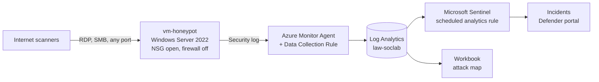

| Component | Detail |
|---|---|
| Subscription | Azure free account |
| Region | Sweden Central (see [Problems I hit](#10-problems-i-hit)) |
| Resource group | `rgsoclab`, so teardown is a single delete |
| Honeypot | `vm-honeypot`, Windows Server 2022 Datacenter, Standard_B2ls_v2 (2 vCPU, 4 GiB) |
| Exposure | NSG rule `DANGER_AllowAnyInbound` (priority 100, any source, any port) and Windows Firewall disabled |
| Logging | Windows Security Events via AMA connector, collecting all security events through a DCR |
| SIEM | Microsoft Sentinel on Log Analytics workspace `law-soclab`, worked in the Defender portal |

## 3. Build

### 3.1 Cost guardrail first

Before creating anything I set a monthly budget (`soclab`, US$20, created 1 Sep) with email alerts. It fired on 28 Sep, once actual spend passed 50% and the forecast passed 100% of the budget.

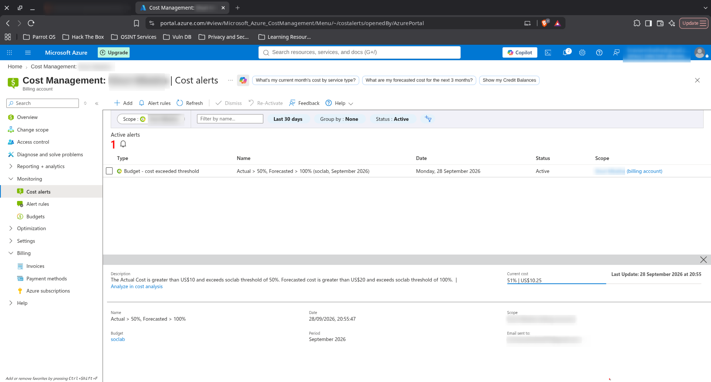

**Evidence:** the 28 Sep alert on the `soclab` budget: actual spend at 51% (US$10.25) of the US$20 budget, forecast above 100%. Shows cost control was set up before the VM existed.

### 3.2 Honeypot VM

I created the resource group and deployed the VM from the portal.

**Result (no screenshot):** a successful deployment of `vm-honeypot` into `rgsoclab`.

I then opened the NSG to all inbound traffic so the VM would attract attacks.

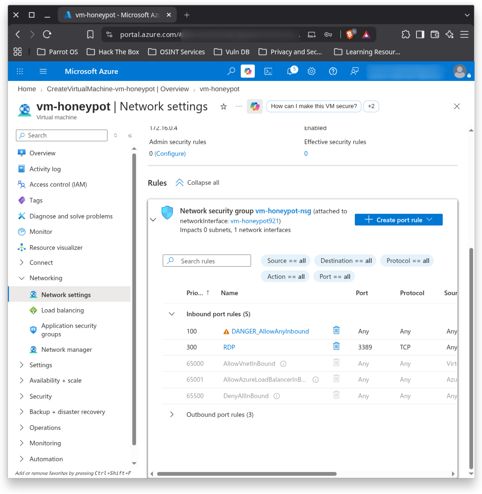

**Evidence:** `DANGER_AllowAnyInbound` at priority 100, above the default rules. The `DANGER_` prefix was deliberate, so the exposure is obvious to anyone reading the config.

I disabled the Windows Firewall using Run Command from the portal, which let me do it without needing RDP access first.

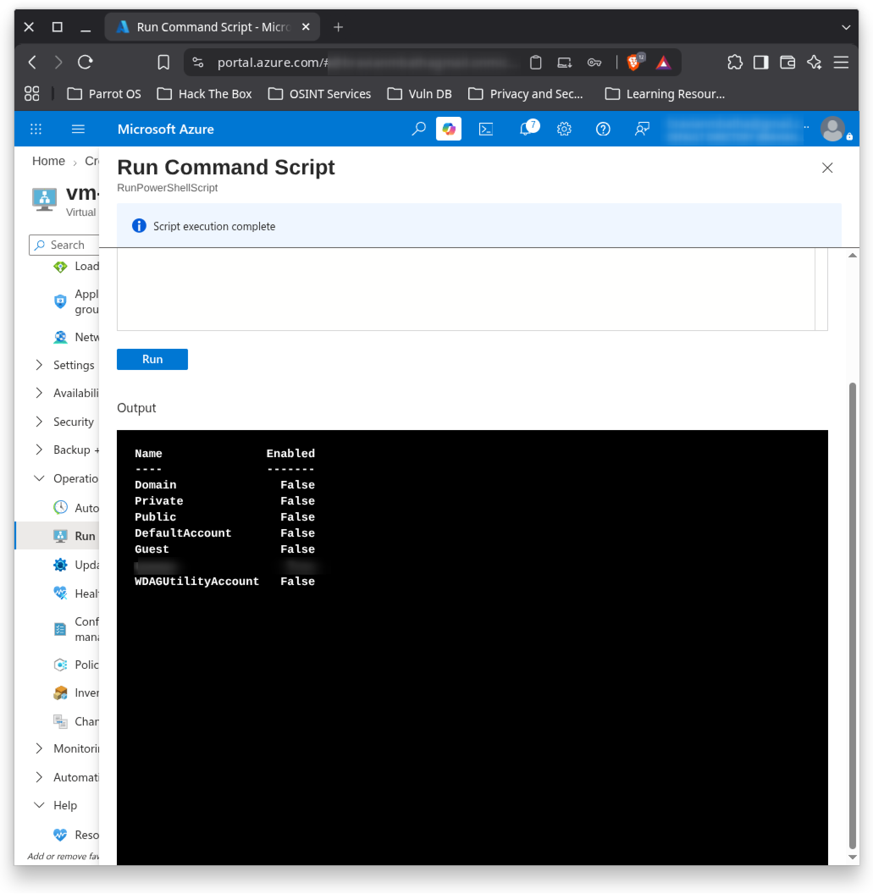

**Evidence:** Domain, Private and Public firewall profiles all show `False`, and the local account list shows the accounts on the VM.

### 3.3 Logging pipeline

I installed the Windows Security Events solution from the Content hub, then created a DCR targeting the VM through the **Windows Security Events via AMA** connector. This replaced the older Log Analytics agent, which is retired.

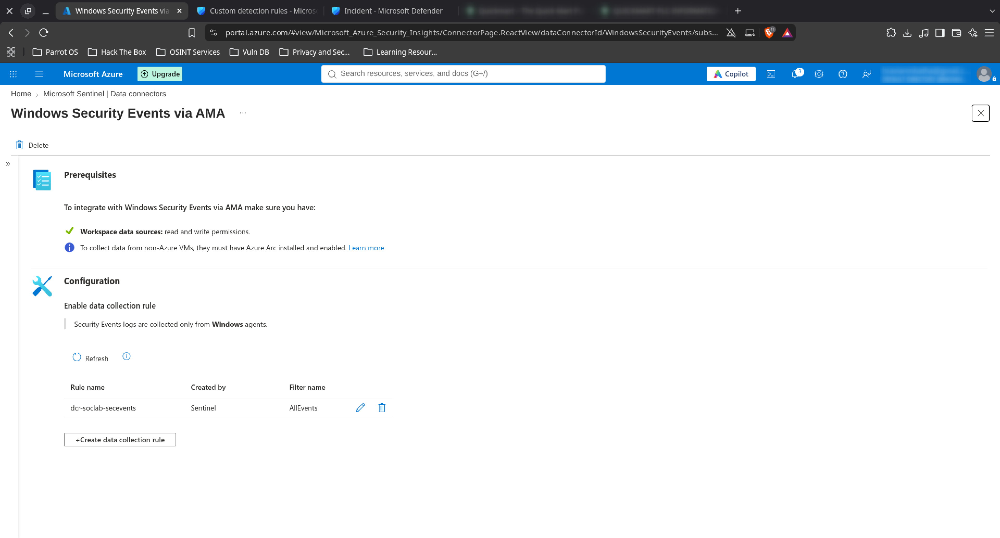

**Evidence:** the connector page showing **Connected**, the DCR, and `vm-honeypot` as its resource.

I verified the pipeline end to end with a first query:

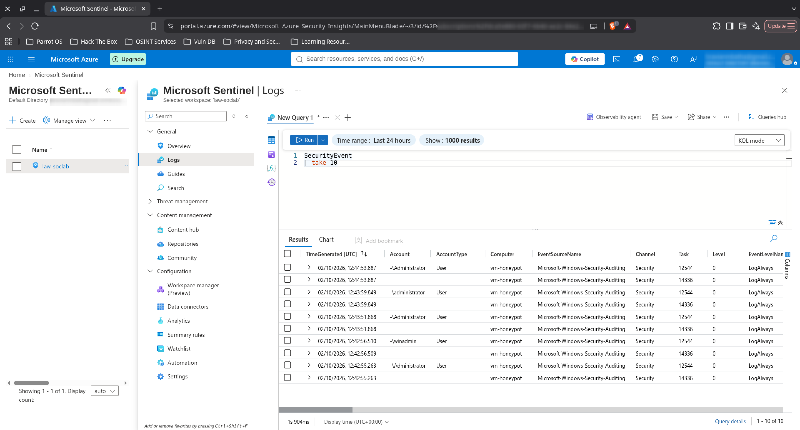

**Evidence:** `SecurityEvent | take 10` returning live events from `vm-honeypot`, including logon attempts against `Administrator` and `winadmin`. This proves the pipeline works.

## 4. What the attackers did

### 4.1 Raw log versus SIEM

Logging into the VM and opening Event Viewer shows the problem a SIEM solves.

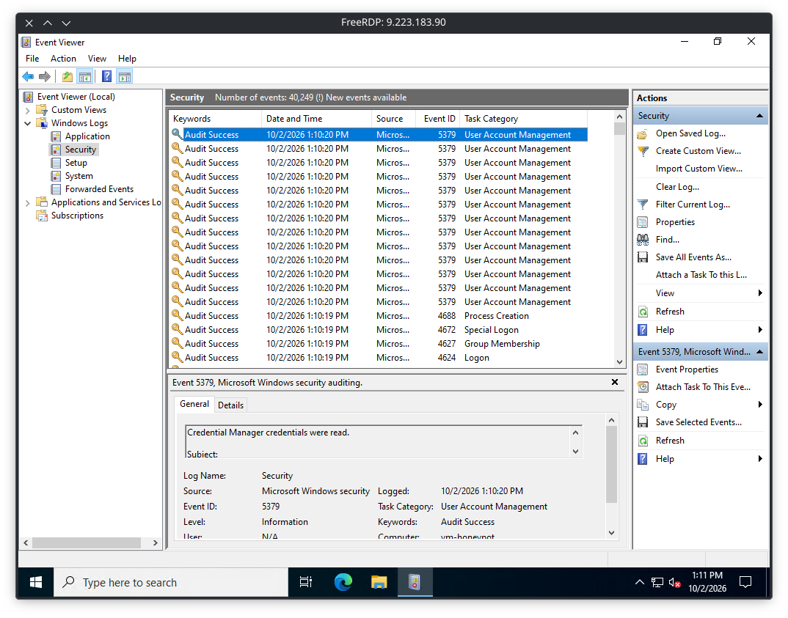

**Evidence:** 40,249 events in the Security log on 2 Oct, after about ten days of exposure (VM deployed 22 Sep, Sentinel collection began 2 Oct). Nobody can review that by hand. The top entries are my own admin session (4624, 4672, 4627, 5379), which shows what legitimate access looks like.

In Sentinel, one failed logon looks like this:

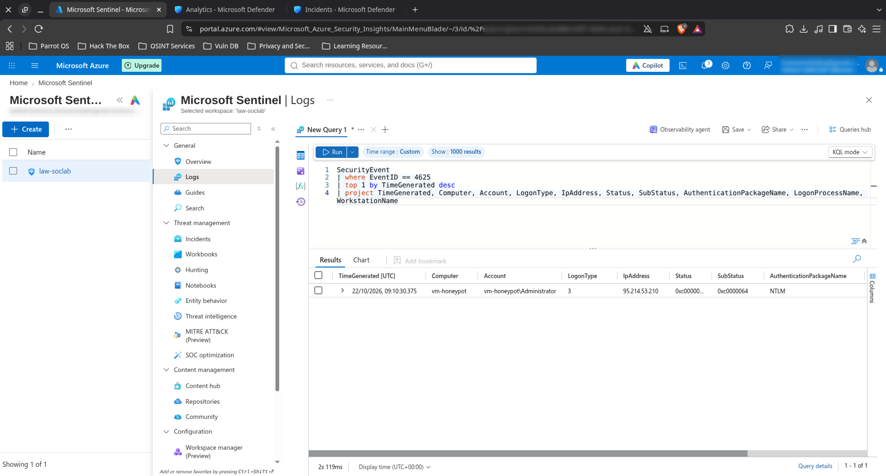

**Evidence:** the most recent 4625 in the dataset (22 Oct, 09:10 UTC), annotated below.

| Field | Value | Meaning |
|---|---|---|
| Account | `vm-honeypot\Administrator` | A guessed name. The built-in Administrator does not exist on this VM |
| Logon Type | 3 | Network logon, not someone at the console |
| Sub Status | `0xC0000064` | The user name does not exist. `0xC000006A` would mean a valid user with a wrong password |
| Authentication Package | NTLM | The VM is not domain-joined, so no Kerberos |
| Source IP | 95.214.53.210 | The scanner's address |

### 4.2 Volume over time

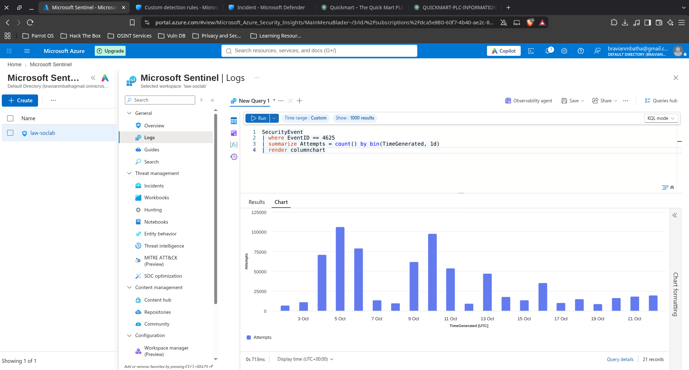

**Evidence:** daily failed logons from 2 to 19 Oct (captured on 19 Oct; the full period runs to 22 Oct) with no gaps in collection. Activity is bursty, not constant: two heavy campaigns of roughly 50,000 to 105,000 attempts a day (4 to 6 Oct and 9 to 11 Oct) with quiet days between. That points to scheduled automated scanning rather than a single targeted attacker.

### 4.3 Who and what

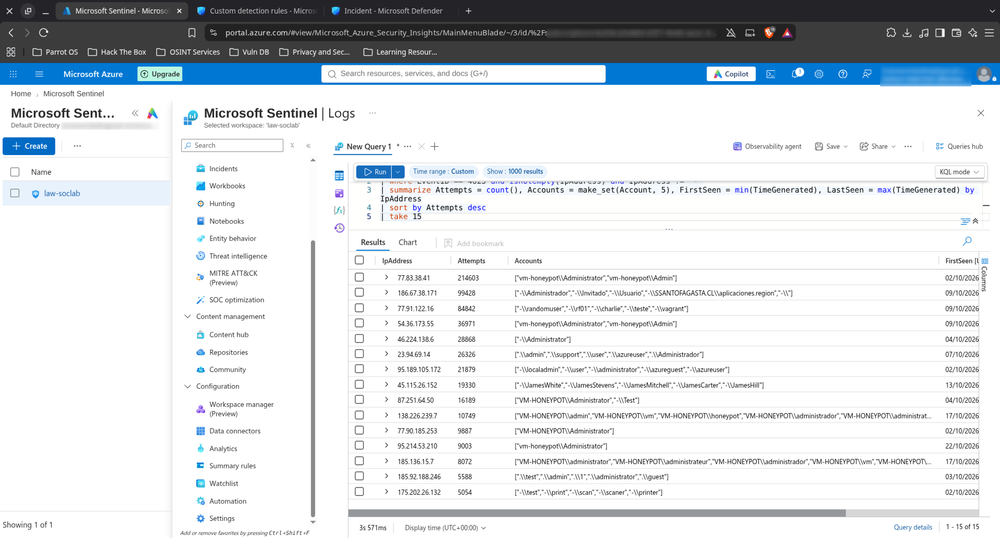

**Evidence:** within the first ten minutes of data (2 Oct), 14 distinct IPs were already attacking. The busiest hit `Administrator` again and again, and another tried Azure-specific default names. By 22 Oct the total was 580 IPs.

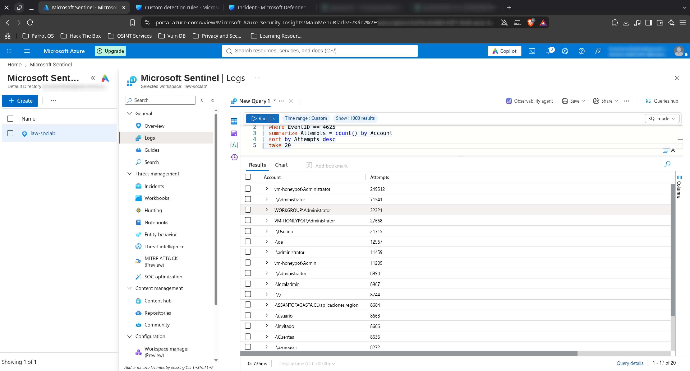

**Evidence:** `Administrator` was tried far more than any other name. Attackers go for the default admin account first, then cloud-flavoured names (`azureuser`, `azadmin`, `vmadmin`, `cloudadmin`). Over the full period 41,849 distinct usernames were tried. This is the argument for renaming or disabling the built-in admin account.

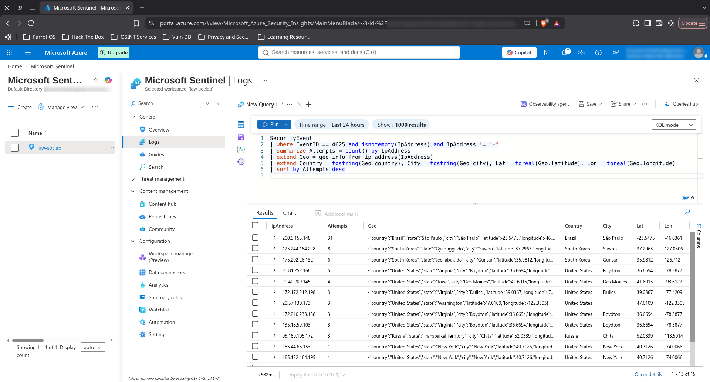

**Evidence:** sources in Brazil, South Korea, Russia and the United States. Several US hits (Boydton VA, Des Moines IA, Dulles VA) are Azure data-centre ranges, so a notable share of the traffic comes from other cloud-hosted machines, probably rented or compromised.

### 4.4 Attack map workbook

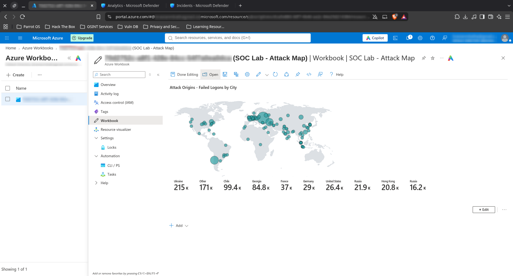

**Evidence:** failed logons by city for 2 to 22 Oct, capped at the 100 largest cities (a workbook map renders only 100 rows). The largest single-city origins were in Ukraine (about 215,000 attempts), Chile (about 99,000) and Georgia (about 85,000). The top-IP and username views are in Figures 10 and 11. The workbook definition is in [`workbook/attack-map.json`](workbook/attack-map.json).

## 5. Detection engineering

### 5.1 The rule

| Setting | Value |
|---|---|
| Name | Brute Force - Multiple Failed Logons from Single IP |
| Type | Scheduled, runs every hour over a one-hour lookback |
| MITRE | Credential Access, T1110 Brute Force |
| Severity | Medium |
| Logic | Failed logons (4625) from one IP, summarised per IP and host, alert above a threshold. Threshold was 10 at launch, raised to 50 later in the lab (see [section 8](#8-tuning-the-detection)) |
| Entity mapping | IP -> `IpAddress`, Host -> `Computer` |

Rule query (launch version):

```kql
SecurityEvent
| where EventID == 4625
| where isnotempty(IpAddress) and IpAddress != "-"
| summarize Attempts = count(), Accounts = make_set(Account, 10) by IpAddress, Computer
| where Attempts >= 10
```

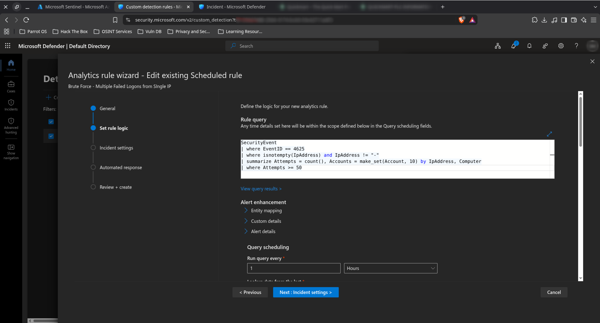

**Evidence:** the rule as finally saved: threshold 50, hourly schedule, one-hour lookback, IP and host entity mapping. The exported rule is in [`rules/brute-force-single-ip.json`](rules/brute-force-single-ip.json).

I validated the rule against live data before relying on it. Eleven IPs cleared the threshold in a single hour, so I knew it would fire.

### 5.2 The rule has been running unattended

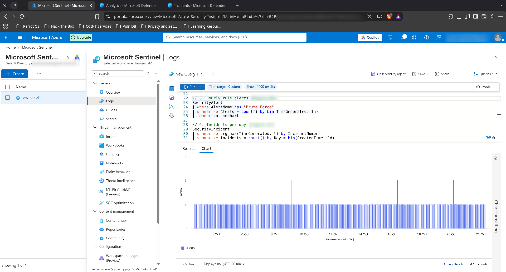

**Evidence:** the Rule runs preview is not available in this tenant, so this shows the rule's output instead: `SecurityAlert` alerts per hour, 477 records in total, with no multi-hour gaps, including the 16 days I did not touch the lab.

## 6. Incident response

### 6.1 The queue

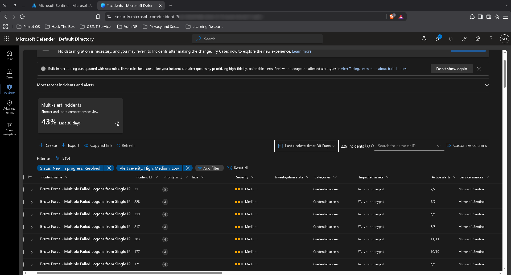

**Evidence:** the queue on 19 Oct showed 229 incidents. By 22 Oct the total was 265 (Figure 34). Every one came from this rule, each with `vm-honeypot` as the impacted asset. For example, incident 228 grouped 8 alerts and incident 21 grouped 7.

My first version of the rule had no entity mapping, so the first 18 incidents showed "No entities to display" and could not be pivoted on. Adding the mapping fixed that, and every later incident carries the IP and host entities.

### 6.2 Triage: incident 228

Incident 228 grouped 8 alerts (01:35 to 10:21 on 19 Oct) covering two source IPs.

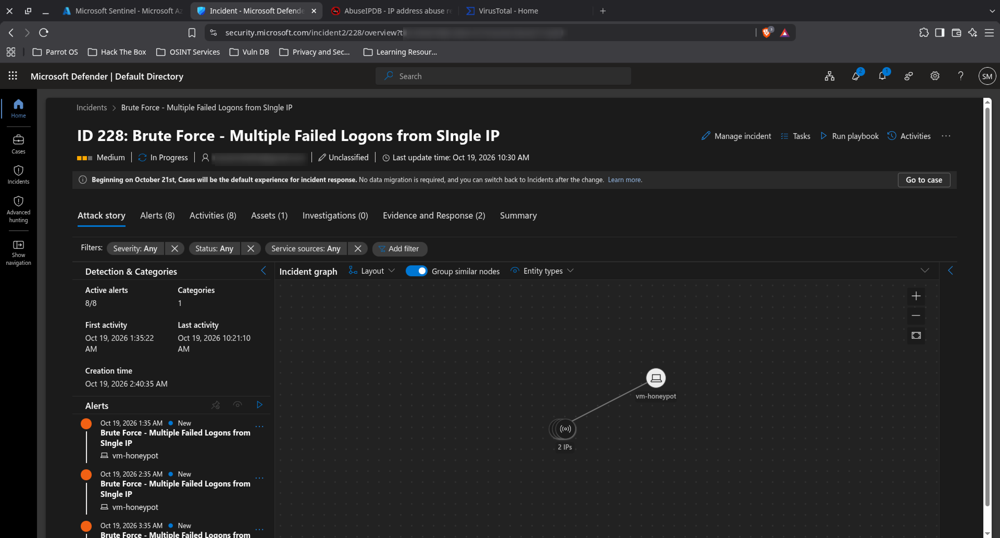

**Evidence:** the incident graph with `vm-honeypot` linked to two IP entities.

I enriched the most persistent source, 23.94.69.14, from three independent places:

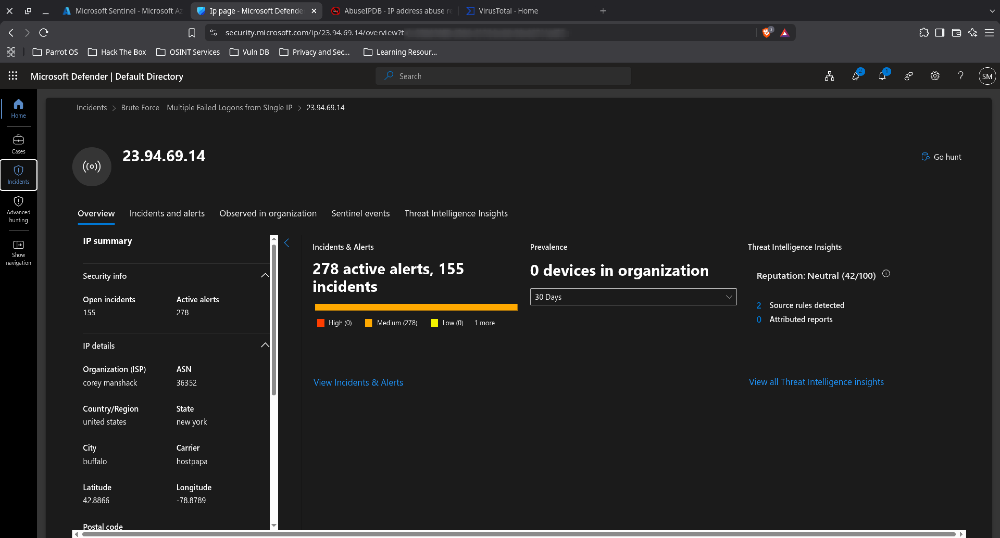

**Evidence:** Defender shows this IP in 278 alerts across 155 incidents in 30 days, with 0 devices in the organisation affected (expected, since this lab has no Defender for Endpoint devices).

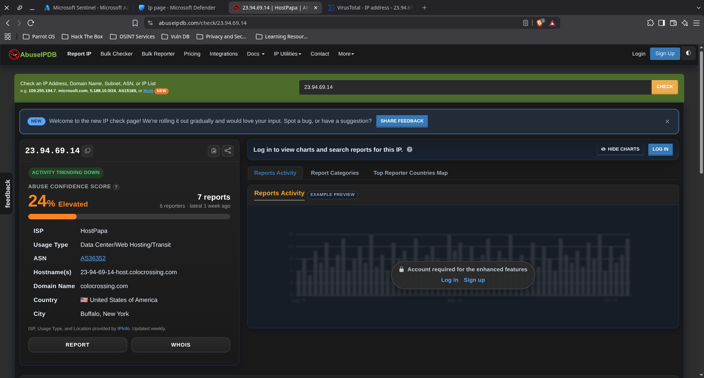

**Evidence:** 24% abuse confidence, 7 reports from 6 reporters, hosting provider in Buffalo NY, activity trending down.

**Result (no screenshot):** on VirusTotal, 2 of 92 vendors flagged it (Fortinet, SOCRadar) and GreyNoise marked it suspicious.

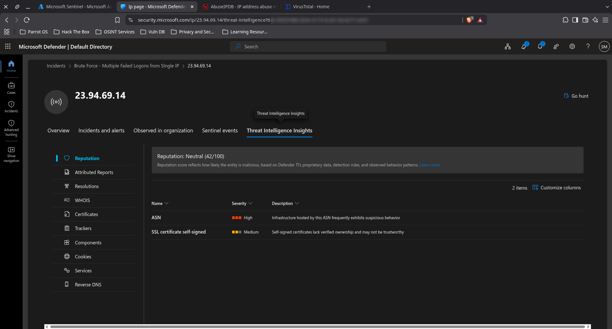

**Evidence:** reputation 42/100 (neutral), with the ASN flagged as high severity and a self-signed certificate noted.

| Source | Verdict |
|---|---|
| AbuseIPDB | 24%, 7 reports |
| VirusTotal | 2/92 malicious, GreyNoise suspicious |
| Defender TI | Neutral (42/100), ASN flagged |
| My telemetry | 278 alerts across 155 incidents in 30 days |

External reputation was mixed. My own telemetry was the stronger evidence: this host attacked persistently, around the clock.

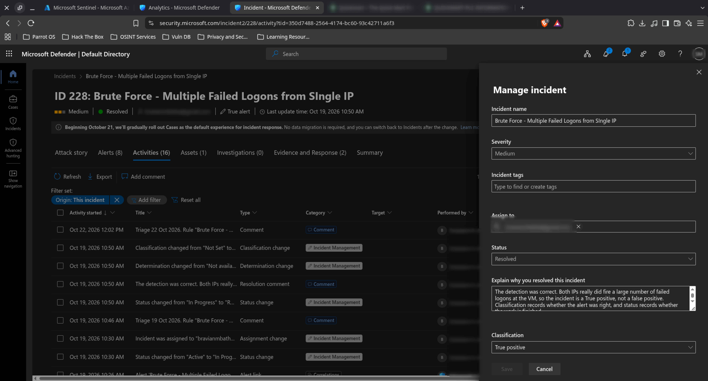

**Evidence:** assignment, comment and classification (True positive, Suspicious activity). Comment text:

> Triage 22 Oct 2026. Rule "Brute Force - Multiple Failed Logons from Single IP" (T1110, Credential Access) raised 8 alerts against vm-honeypot. Source IPs: 23.94.69.14 and 185.136.15.7. 23.94.69.14: hosting IP (AS36352), AbuseIPDB 24% / 7 reports, VirusTotal 2/92, Defender TI 42/100, present in 278 alerts / 155 incidents over 30 days. Verified against the full collection period (2-22 Oct): no 4624 logon from either IP. Conclusion: True positive, automated password guessing against an intentionally exposed honeypot. No successful authentication, no containment required.

I chose not to block the source IPs. The honeypot exists to observe attacks, and these attackers rotate addresses constantly. In production I would add NSG deny rules or put RDP behind a bastion.

### 6.3 Why one incident held eleven IPs

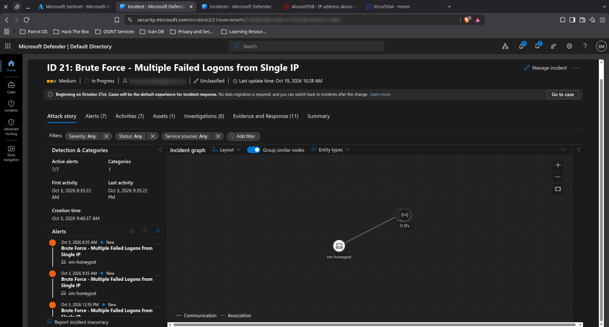

**Evidence:** incident 21 groups 7 alerts covering 11 different IPs. Each alert bundled every IP over the threshold in that hour, which stopped incident grouping from working per attacker. This is the root cause of the noise discussed in section 8.

## 7. Compromise assessment

With 723,986 guesses against the VM, the real question is whether any worked.

| Check | Query | Result |
|---|---|---|
| Successful external logons (types 3 and 10) | Query 6 | Over the full 2 to 22 Oct period: one authenticated external login, my own admin account from my home IP (two events at 13:08 UTC on 2 Oct, within a minute of my portal password reset), which is my own RDP session. Three anonymous logons from 154.192.128.209 (16 Oct), 3.101.54.187 (18 Oct) and 217.218.243.203 (21 Oct): unauthenticated connections consistent with SMB/RPC scanning, not a credential compromise |
| New users, group changes, cleared logs | Query 7 | None of 4720, 4732 or 1102 found over the full 2 to 22 Oct period |
| Password resets (4724) | Query 7 | One, on 2 Oct, performed by the machine account when I reset the admin password through the Azure portal |
| Scheduled tasks (4698), a persistence technique | Query 8 | Five tasks on 14 Oct, all created by SYSTEM (LogonId 0x3e7): three Windows Update Orchestrator tasks running `MusNotification.exe` from system32, and two Defender maintenance tasks from the standard Defender platform folder. Routine OS activity |


**Evidence:** the only authenticated external logon is my own account, plus three anonymous network logons.

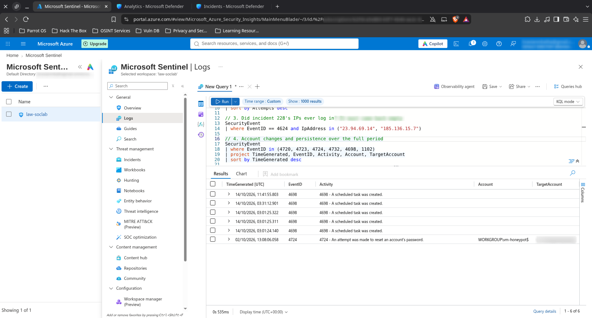

**Evidence:** the 4698 and 4724 results over the full period.

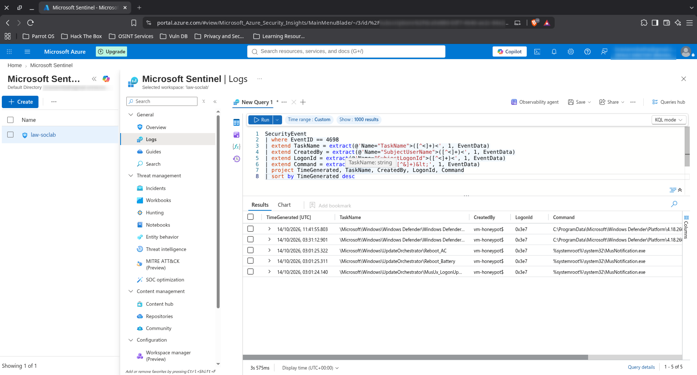

**Evidence:** the task details showing SYSTEM as creator and signed Windows binaries in standard paths.

**Failure reasons (Figures 31 to 33).** Of 723,986 failures, 719,251 (99.3%) were "user name does not exist" (`0xC0000064`), 4,313 were `0x0`, 391 were "wrong password" (`0xC000006A`) and 31 were "account disabled" (`0xC0000072`). The wrong-password hits landed on the built-in Guest, DefaultAccount and WDAGUtilityAccount accounts, which Windows disables by default, plus one failure from my own IP on 2 Oct before I connected. No attacker ever found a valid username with a wrong password.

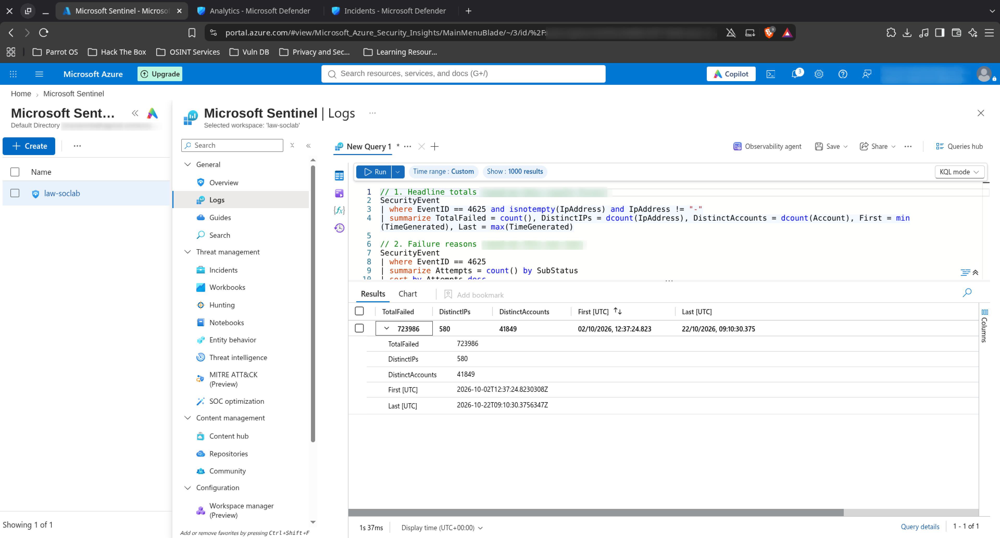

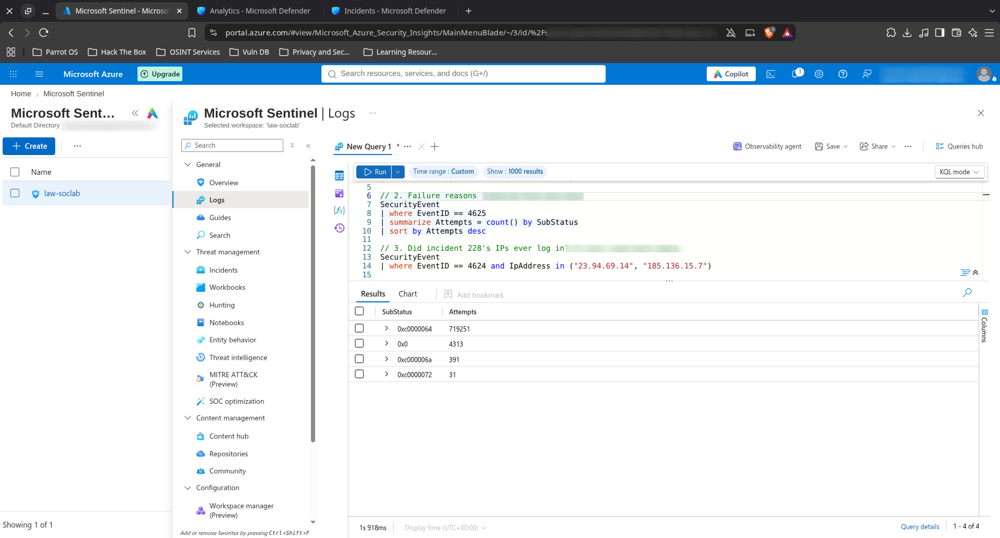

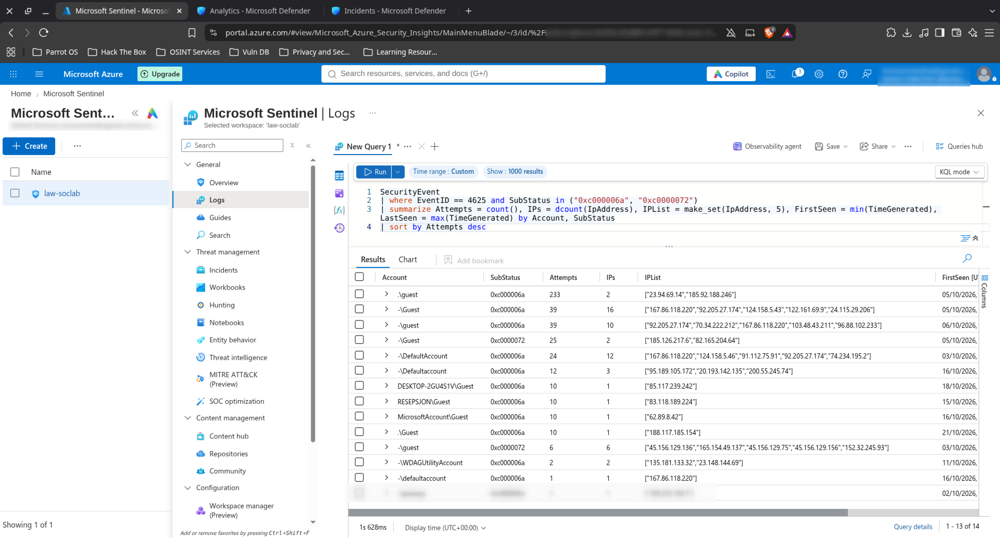

**Conclusion:** no evidence of compromise. The anonymous logons do show that scanners reach services beyond RDP, because the NSG allows every port.

## 8. Tuning the detection

**Problem.** Over 2 to 22 Oct the rule raised 265 incidents, between 8 and 19 a day. One persistent source, 23.94.69.14, accounted for 155 of the first 229. That is alert fatigue: an analyst would stop reading the queue.

**Causes I identified.**

1. A low threshold of 10 failures per IP per hour, easily cleared by commodity scanners.
2. Event grouping set to a single alert for all results, so each alert bundled many IPs (incident 21 held 11) and defeated per-IP incident grouping.

**What I changed.** I raised the threshold from 10 to 50. Event grouping stayed on a single alert and incident grouping stayed on matching IP entities within 5 hours.

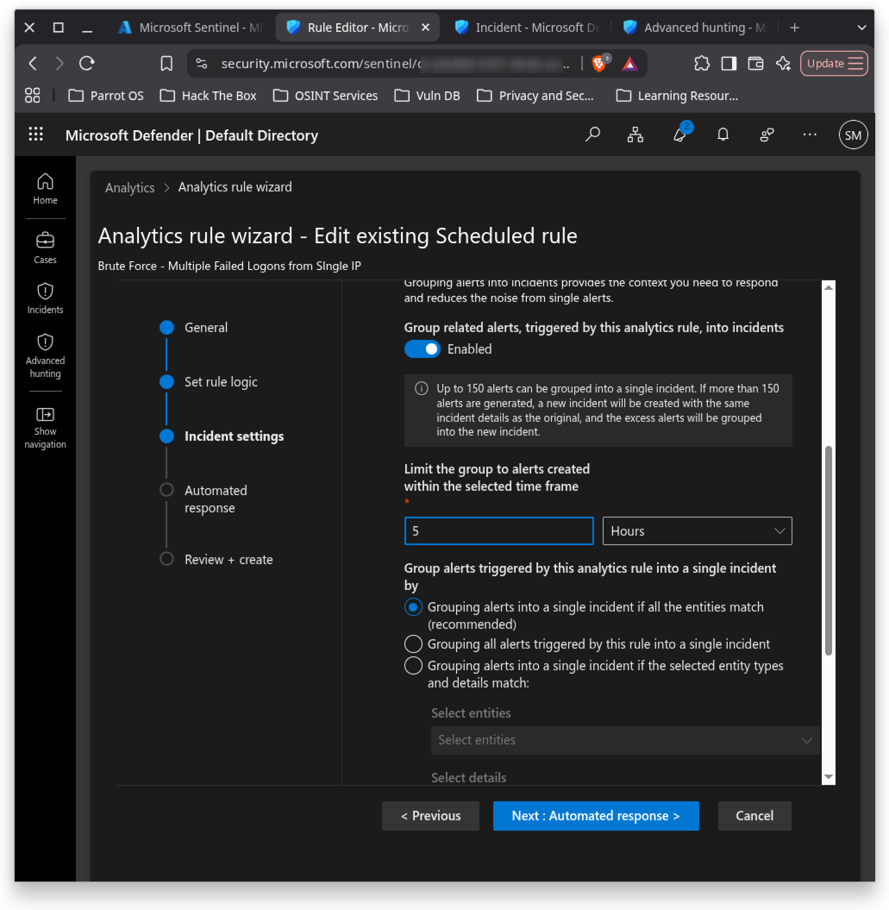


**Evidence:** incidents created per day, 2 to 22 Oct.

**Result.** No measurable effect. Before the change the rule averaged about 13 incidents a day (3 to 18 Oct, range 10 to 19). On the two full days after it (20 and 21 Oct) it raised 11 a day, inside the same range, and the hourly alert chart (Figure 15) shows no visible change. The reason is structural. With one alert per run, any single IP clearing 50 failures in an hour is enough to fire the rule, and the heaviest scanners send thousands an hour, so the rule still fires almost every hour whatever the threshold is.

**What I would try next (untested).** Create one alert per IP (event grouping per result) and group incidents by IP over 24 hours, so a persistent scanner lands in one incident instead of dozens. I would check the effect with Query 10 and Query 11 over a week before trusting it. I ran out of free-subscription time to test this.

## 9. Cost

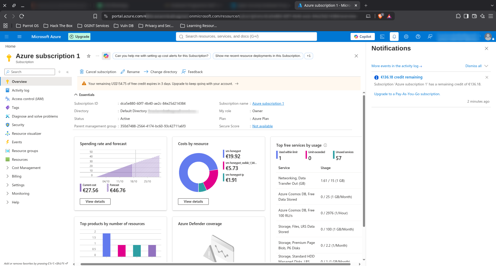

**Evidence:** 27.56 EUR spent this billing period (19 Oct) with a 46.76 EUR forecast. By resource: VM 19.92 EUR, OS disk 5.73 EUR, public IP 1.91 EUR. 136.18 EUR of credit remained with the credit expiring in 3 days.

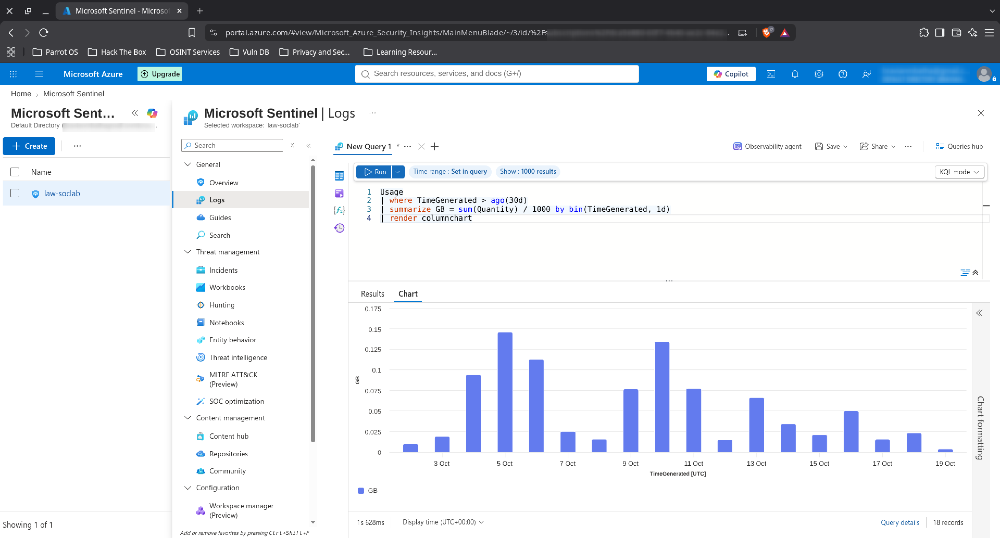

**Evidence:** Sentinel ingestion below 0.15 GB a day, far inside the free-trial allowance. The VM is the whole cost. Logging was negligible.

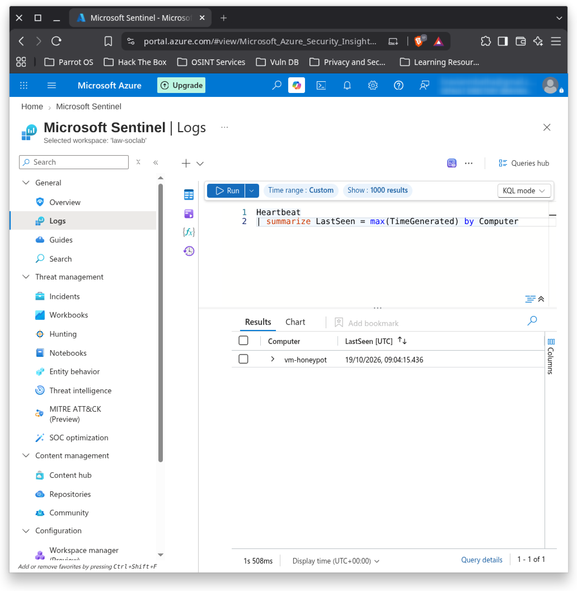

**Evidence:** `vm-honeypot` heartbeat, last seen 19 Oct 09:04 UTC at the time of capture.

## 10. Problems I hit

| Problem | Cause | Fix |
|---|---|---|
| VM size rejected | `Standard_D2s_v3` returned NotAvailableForSubscription in North Europe | Used a B-series size |
| Deployment rejected in West Europe | Region not accepting new customers on this subscription | Moved everything to Sweden Central |
| Sentinel page empty | The workspace had never been added to Sentinel | Re-ran the Add step and waited for completion |
| RDP login failures | Mistyped admin username and a missing space between FreeRDP flags | Read the real account list via Run Command |
| First 18 incidents unusable | No entity mapping on the rule | Added IP and Host mapping |
| 265 incidents from one rule | Low threshold and multi-IP alerts | Raised the threshold (no effect); per-IP grouping proposed in section 8 |
| Workbook map empty | A workbook map renders only the first 100 rows and I had one row per IP | Aggregated by city, top 100 |
| Map legend tiles all showed 0 | Legend metric was set to City | Set it to Attempts |
| Rule runs preview unavailable | Not offered in this tenant | Used an hourly `SecurityAlert` chart as evidence |
| Outdated tutorials | Log Analytics agent retired; Sentinel moved into the Defender portal | Used AMA with a DCR and the Defender portal |

## 11. Hardening recommendations

What I would do on a real internet-facing Windows host:

1. Do not expose RDP. Use Azure Bastion or just-in-time access, or restrict the NSG to known source IPs.
2. Rename or disable the built-in admin account, since it takes the bulk of the guesses.
3. Enforce an account lockout policy. Under NTLM this alone would remove most of the volume.
4. Require MFA or a VPN in front of administrative access.
5. Keep the Windows Firewall on and close SMB and RPC to the internet.
6. In Sentinel, add threat-intelligence enrichment, an automation rule to tag known scanners, and a playbook that adds repeat offenders to an NSG deny list.

## 12. Limitations

- One VM, one rule and one data source, so this is a lab, not a production design.
- Sentinel only holds data from 2 Oct, when the agent connected. Earlier events exist only in the VM's local log.
- Geolocation and reputation data are approximate, and attack counts are failed logons, not unique attackers.
- The honeypot was deliberately exposed on every port, so these numbers overstate normal internet background noise.
- I did not simulate post-exploitation activity, so the compromise checks were negative by observation, not tested against a known attack.
- The only tuning I applied (threshold 10 to 50) had no measurable effect, and the per-IP grouping change I propose is untested.
- The before/after comparison uses only two full days after the change, so it cannot show a small effect.

## 13. Teardown and safety

The lab used an isolated free-trial subscription with no real data, no credentials reused elsewhere, and nothing connected to any other system. The free-trial credit expired on 22 Oct 2026. The lab is no longer running.

## 14. MITRE ATT&CK coverage

| Technique | Status |
|---|---|
| T1110 Brute Force | Detected by scheduled rule |
| T1021.001 Remote Services: RDP | Exposure observed, no successful attacker access |
| T1078 Valid Accounts | Reviewed successful logons, only my own account, plus three anonymous network logons |
| T1136 Create Account | Checked (4720), none found |
| T1053.005 Scheduled Task | Checked (4698), only routine OS tasks |
| T1070.001 Clear Windows Event Logs | Checked (1102), none found |

---

## Appendix A: Screenshot index

All figures are in `screenshots/`. Figures 26 and 28 do not exist: the tuning experiment they would have shown did not produce a measurable result.

| # | Filename | Capture |
|---|---|---|
| 01 | `01-budget-alert.png` | Cost alert for 28 Sep |
| 03 | `03-nsg-rules.png` | NSG inbound rules with `DANGER_AllowAnyInbound` |
| 04 | `04-firewall-disabled.png` | Run Command output, three profiles False |
| 05 | `05-connector-dcr.png` | Windows Security Events via AMA connector, Connected, DCR |
| 06 | `06-first-events.png` | `SecurityEvent \| take 10` results |
| 07 | `07-event-viewer-40249.png` | Event Viewer Security log, 40,249 events |
| 08 | `08-event-4625-detail.png` | One 4625 event with fields |
| 09 | `09-failed-logons-per-day.png` | Daily 4625 column chart, 2 to 19 Oct |
| 10 | `10-top-attacking-ips.png` | Failed logons by IP with accounts tried |
| 11 | `11-targeted-usernames.png` | Most targeted usernames |
| 12 | `12-geolocation.png` | Geolocation query results |
| 13 | `13-workbook-attack-map.png` | Workbook attack map |
| 14 | `14-rule-config.png` | Rule logic as saved (threshold 50) |
| 14b | `14b-rule-incident-grouping.png` | Incident grouping settings |
| 15 | `15-rule-runs.png` | Hourly SecurityAlert chart (477 records) |
| 16 | `16-incident-queue.png` | Incident list, 19 Oct (229 incidents) |
| 17 | `17-incident-228-graph.png` | Incident 228 attack story |
| 18 | `18-ip-page-overview.png` | Defender IP page for 23.94.69.14 |
| 19 | `19-abuseipdb.png` | AbuseIPDB result |
| 21 | `21-defender-ti.png` | Defender threat intelligence reputation |
| 22 | `22-incident-228-comment.png` | Incident 228 with comment, resolved, classified |
| 23 | `23-incident-21-graph.png` | Incident 21 with 11 IPs |
| 24 | `24-successful-logons.png` | Query 6 results, full period |
| 25 | `25-persistence-checks.png` | Query 7 results, full period |
| 25b | `25b-scheduled-tasks-4698.png` | Query 8 scheduled task details |
| 27 | `27-incidents-per-day.png` | Incidents per day, 2 to 22 Oct |
| 29 | `29-cost-and-credit.png` | Subscription overview with cost and credit banner |
| 30 | `30-health-and-ingestion.png` | Ingestion chart |
| 30b | `30b-heartbeat.png` | Agent heartbeat |
| 31 | `31-headline-totals.png` | Query 1: 723,986 failed logons, 580 IPs, 41,849 usernames |
| 32 | `32-failure-reasons.png` | Failure reasons by SubStatus |
| 33 | `33-wrong-password-accounts.png` | Wrong-password and disabled-account hits by account |
| 34 | `34-incident-total.png` | Total incidents: 265 |

## Appendix B: KQL queries

Run all of these in Sentinel Logs. Use a custom range of 2 Oct to 22 Oct, the full collection period, unless stated.

**Query 1: headline totals**

```kql
SecurityEvent
| where EventID == 4625 and isnotempty(IpAddress) and IpAddress != "-"
| summarize TotalFailed = count(), DistinctIPs = dcount(IpAddress), DistinctAccounts = dcount(Account), First = min(TimeGenerated), Last = max(TimeGenerated)
```

**Query 2: failed logons per day**

```kql
SecurityEvent
| where EventID == 4625
| summarize Attempts = count() by bin(TimeGenerated, 1d)
| render columnchart
```

**Query 3: top attacking IPs**

```kql
SecurityEvent
| where EventID == 4625 and isnotempty(IpAddress) and IpAddress != "-"
| summarize Attempts = count(), Accounts = make_set(Account, 10), FirstSeen = min(TimeGenerated), LastSeen = max(TimeGenerated) by IpAddress
| sort by Attempts desc
```

**Query 4: most targeted usernames**

```kql
SecurityEvent
| where EventID == 4625
| summarize Attempts = count() by Account
| sort by Attempts desc
| take 20
```

**Query 5: geolocation**

```kql
SecurityEvent
| where EventID == 4625 and isnotempty(IpAddress) and IpAddress != "-"
| summarize Attempts = count() by IpAddress
| extend Geo = geo_info_from_ip_address(IpAddress)
| extend Country = tostring(Geo.country), City = tostring(Geo.city), Latitude = toreal(Geo.latitude), Longitude = toreal(Geo.longitude)
| sort by Attempts desc
```

**Query 6: successful external logons**

```kql
SecurityEvent
| where EventID == 4624 and LogonType in (3, 10)
| where isnotempty(IpAddress) and IpAddress != "-"
| summarize Logons = count(), Accounts = make_set(Account), FirstSeen = min(TimeGenerated), LastSeen = max(TimeGenerated) by IpAddress
```

**Query 7: account changes, persistence and log clearing**

```kql
SecurityEvent
| where EventID in (4720, 4723, 4724, 4732, 4698, 1102)
| project TimeGenerated, EventID, Activity, Account, TargetAccount
| sort by TimeGenerated desc
```

**Query 8: scheduled task details**

```kql
SecurityEvent
| where EventID == 4698
| extend TaskName = extract(@'Name="TaskName">([^<]+)<', 1, EventData)
| extend CreatedBy = extract(@'Name="SubjectUserName">([^<]+)<', 1, EventData)
| extend LogonId = extract(@'Name="SubjectLogonId">([^<]+)<', 1, EventData)
| extend Command = extract(@'Command&gt;([^&]+)&lt;', 1, EventData)
| project TimeGenerated, TaskName, CreatedBy, LogonId, Command
| sort by TimeGenerated desc
```

**Query 9: why did the logons fail?** `0xc000006a` means a real account with a wrong password. Result: 99.3% unknown user (`0xc0000064`), 391 wrong password, 31 disabled.

```kql
SecurityEvent
| where EventID == 4625
| summarize Attempts = count() by SubStatus
| sort by Attempts desc
```

**Query 10: threshold analysis** (written for tuning; not run before the subscription ended)

```kql
SecurityEvent
| where EventID == 4625 and isnotempty(IpAddress) and IpAddress != "-"
| summarize Attempts = count() by IpAddress, bin(TimeGenerated, 1h)
| summarize AtLeast10 = countif(Attempts >= 10), AtLeast30 = countif(Attempts >= 30), AtLeast100 = countif(Attempts >= 100) by Day = bin(TimeGenerated, 1d)
```

**Query 11: incidents created per day**

```kql
SecurityIncident
| summarize arg_max(TimeGenerated, *) by IncidentNumber
| summarize Incidents = count() by Day = bin(CreatedTime, 1d)
| render columnchart
```

**Query 12: workbook attack map**

```kql
SecurityEvent
| where EventID == 4625 and isnotempty(IpAddress) and IpAddress != "-"
| summarize Attempts = count() by IpAddress
| extend Geo = geo_info_from_ip_address(IpAddress)
| extend Country = tostring(Geo.country), City = tostring(Geo.city), Latitude = round(toreal(Geo.latitude), 2), Longitude = round(toreal(Geo.longitude), 2)
| where isnotnull(Latitude)
| summarize Attempts = sum(Attempts), IPs = count() by Country, City, Latitude, Longitude
| top 100 by Attempts desc
```

**Query 13: wrong-password and disabled-account failures by account**

```kql
SecurityEvent
| where EventID == 4625 and SubStatus in ("0xc000006a", "0xc0000072")
| summarize Attempts = count(), IPs = dcount(IpAddress), IPList = make_set(IpAddress, 5), FirstSeen = min(TimeGenerated), LastSeen = max(TimeGenerated) by Account, SubStatus
| sort by Attempts desc
```

**Query 14: total incidents**

```kql
SecurityIncident
| summarize arg_max(TimeGenerated, *) by IncidentNumber
| summarize TotalIncidents = count(), First = min(CreatedTime), Last = max(CreatedTime)
```

**Query 15: did incident 228's IPs ever log in?** An empty result means no.

```kql
SecurityEvent
| where EventID == 4624 and IpAddress in ("23.94.69.14", "185.136.15.7")
```

---

## Repository layout

```
.
├── README.md
├── screenshots/        # figures 01 to 34 (26 and 28 intentionally omitted)
├── queries/            # one .kql file per query in Appendix B
├── rules/              # exported analytics rule (JSON)
└── workbook/           # exported workbook (JSON)
```
